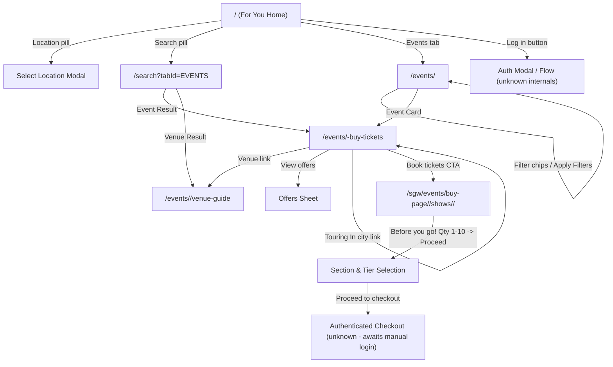

# District Website Navigation & State Map (Observed)

Source: REA passive CDP observations (`ev_b54e2a34`, `ev_522a1a64`, `ev_65d947cc`, `ev_0fafc9f7`, `ev_c8232a8d`, `ev_2edc505d`, `ev_24cea136`, `ev_8b0f4fed`, `ev_6d0b905c`).

## Notes
- Unauthenticated public traversal ends at the transactional buy-page (`/sgw/events/buy-page/...`) after selecting ticket quantity (`1`–`10`) and clicking `Proceed`.
- Auth-gated checkout, payment handoff, and post-purchase ticket wallet screens remain marked `unknown` pending manual owner authentication.
