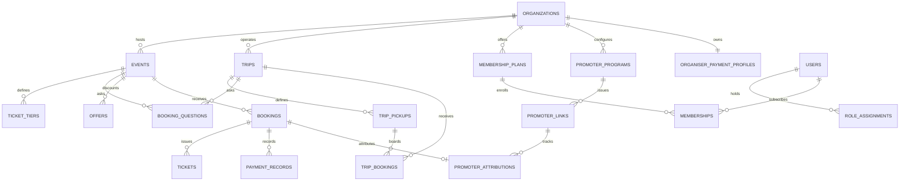
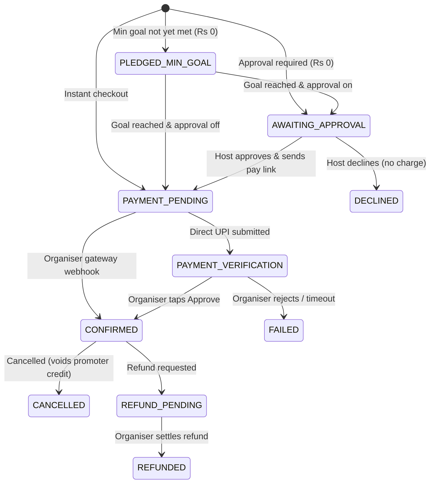

# NIGHTLIFEZ × Yano — Integration Specification

**Status:** Research & Architecture Proposal (No SQL migrations or application code implemented)  
**Baseline:** `feature/nightlifez-full-platform` (`c71826a`)  
**Source Evidence:** [REA_FEATURE_MATRIX.md](file:///Users/pradeepjakuraa/nightlifez-dist/district-app-research/research/yano/REA_FEATURE_MATRIX.md)

---

## 1. Architectural Principles & Non-Negotiable Guardrails

1. **Reuse Existing Core First:** Preserve NIGHTLIFEZ's unified identity (`users`, `sessions`, phone OTP + email auth), `role_assignments` (`organizationId`, `venueSlug`, `eventId`), `bookings`, `tickets`, HMAC-signed `NLZ1` QR tokens (`auth.ts`), `offers`, `refund_requests`, and `audit_logs`.
2. **Direct-to-Organiser Funds (No Platform Custody):** Extend `paymentAdapter.ts` (`payment_records`) so NIGHTLIFEZ supports approved direct-to-organiser payment integrations (organiser-connected Razorpay/Cashfree accounts or direct UPI payment with explicit `PENDING_VERIFICATION` -> organiser confirmation), rather than automatic platform custody of seller funds.
3. **Strict Financial Isolation for Door/Trip Staff:** `checkin_staff`, `box_office`, and trip-stop coordinators MUST NEVER receive `org:settlements:read`, `org:reports:read`, `platform:ledger:read`, or promoter payout visibility.
4. **No Gender/Sensitive Attribute Crowd Balancing:** Yano's 50:50 gender auto-pause is rejected. Crowd balancing in NIGHTLIFEZ must use **gender-neutral tier-ratio/capacity caps** (e.g., max share per tier or paired quota rules).
5. **No Automatic External Chat Group Mutations:** Paid Groups must NOT claim automatic WhatsApp, Telegram, or Discord member removal. Access control relies on gated invite links shown only to `ACTIVE` members, link rotation, and an expiry roster for manual admin action.
6. **Trip Boarding Separation:** Trip pickup selection, boarding manifests, and balance-due collection MUST live in a dedicated `Trips` module separate from ordinary `events` check-in (`verifyAndCheckInTicket`).
7. **Pricing Model Independence:** Retain NIGHTLIFEZ's configurable fee/offer engine (`pricing.ts`) rather than copying Yano's ₹6–₹10 prepaid credit model.

---

## 2. Proposed Module Architecture & Entity Relationships

### Module Breakdown

| Module | Reuse Existing | New Capability |
| :--- | :--- | :--- |
| **1. Storefront & Listing Mgmt** | `organizations`, `events`, `venues`, `upsertOrganiserEvent` | Public `/o/[orgSlug]` link-in-bio page, listing duplication (`cloneEvent`), `visibility` (`PUBLIC` / `UNLISTED` / `INVITE_ONLY`), embed mode (`/embed/events/[slug]`), dry-run preview mode. |
| **2. Guest & Approval Mgmt** | `bookings`, `tickets`, `signQrPayload`, `box_office` role | Custom booking questions + answers, pre-payment approval queue (`AWAITING_APPROVAL` -> pay link), manual walk-in/cash pass issuance, CSV guest import, printable A4 manifest. |
| **3. Crowd Goals & Pass Controls** | `ticket_tiers`, `inventory_holds`, `event_occurrences`, `offers` | Event/trip `min_guest_goal` (`₹0` pledge -> pay-link trigger), gender-neutral paired-tier ratio caps, per-phone/per-user order limits, multi-day `occurrence_id` gate validation, `?offer=` URL auto-apply. |
| **4. Trips Operations** | `organizations`, `users`, `role_assignments`, `payment_records` | `trips`, `trip_pickups`, `trip_bookings`, advance + balance-due ledger, stop-scoped boarding & `"I received"` balance confirmation, Trip Captain contact metadata. |
| **5. Paid Groups & Memberships** | `organizations`, `users`, `notifications`, `payment_records` | `membership_plans`, `memberships` (30-day periods), private rotatable invite link, 5-day expiry email/notification reminders, manual renewal & ended-member roster. |
| **6. Promoters & Referrals** | `organizations`, `events`, `offers`, `bookings`, `audit_logs` | `promoter_programs`, `promoter_links` (`?ref=`), `promoter_attributions` (fixed commission per paid non-cancelled booking), `promoter_payouts` (manual UPI + organiser acknowledgement). |
| **7. Staff & Door Operations** | `/staff`, `verifyAndCheckInTicket`, `syncOfflineScans`, `lookupEventTickets` | Scoped event/stop operator invite tokens mapped to `checkin_staff`/`box_office`, filterable guest list (tier, status, stop), camera QR scan UI, strict financial isolation. |
| **8. Organiser Money & Reconciliation** | `payment_records`, `refund_requests`, `ledger_entries`, `audit_logs` | `organiser_payment_profiles` (direct UPI ID / own Razorpay or Cashfree credentials reference), organiser manual UPI approval, monthly organiser statements, buyer issue flags. |

---

## 3. Conceptual Data Model Additions

*(Conceptual entities and extensions only — no DDL/SQL migrations generated.)*

### A. Extensions to Existing Tables
- **`organizations`**: Add `bio_intro`, `cover_artwork_url`, `instagram_handle`, `public_contact_phone`, `show_public_storefront` (boolean), `open_issues_count`.
- **`events`**: Add `visibility` (`PUBLIC | UNLISTED | INVITE_ONLY`), `approval_required` (boolean), `min_guest_goal` (integer, nullable), `goal_deadline_at`, `cloned_from_event_id`, `max_per_user_or_phone` (integer, nullable), `allow_embed` (boolean).
- **`ticket_tiers`**: Add `tier_group_key` and `max_lead_over_paired_tier` (nullable integer, gender-neutral balancing cap), `occurrence_id` (nullable link to `event_occurrences` for day-pass vs all-days enforcement).
- **`bookings`**: Add `approval_status` (`NOT_REQUIRED | PENDING | APPROVED | DECLINED`), `booking_source` (`ONLINE | BOX_OFFICE | CSV_IMPORT | EMBED`), `custom_answers_json`, `promoter_link_id` (nullable), `payment_channel` (`ORGANISER_UPI | ORGANISER_GATEWAY | CASH_DOOR | DEMO_SANDBOX`).
- **`offers`**: Add `promoter_link_id` (nullable) to support promoter-specific discount codes.
- **`role_assignments` / `staff_invitations`**: Add optional `trip_id` and `pickup_id` (nullable) so Trip Captains / stop coordinators remain within NIGHTLIFEZ's single scoped RBAC model.

### B. New Conceptual Entities
1. **`organiser_payment_profiles`**: `id`, `organization_id`, `mode` (`DIRECT_UPI | OWN_RAZORPAY | OWN_CASHFREE | SANDBOX`), `upi_vpa` (masked/validated), `gateway_account_ref` (encrypted/vault reference, never exposed to clients or staff), `verification_status`, `refund_contact_note`.
2. **`booking_questions`**: `id`, `target_type` (`EVENT | TRIP | MEMBERSHIP`), `target_id`, `label`, `field_type` (`TEXT | NUMBER | PHONE | INSTAGRAM_HANDLE | SELECT`), `options_json`, `required`, `sort_order`.
3. **`trips`**: `id`, `organization_id`, `slug`, `title`, `summary`, `starts_at`, `ends_at`, `nights_count`, `approval_required`, `min_group_size`, `advance_amount_inr`, `total_price_inr`, `captain_name`, `captain_phone`, `visibility`, `lifecycle_status`.
4. **`trip_pickups`**: `id`, `trip_id`, `name`, `address_note`, `boarding_at`, `sort_order`.
5. **`trip_bookings`**: `id`, `trip_id`, `pickup_id`, `user_id`, `traveller_name`, `traveller_phone`, `traveller_email`, `seat_tier_label`, `custom_answers_json`, `approval_status` (`PENDING | APPROVED | DECLINED`), `payment_status` (`UNPAID | ADVANCE_PENDING_VERIFY | ADVANCE_PAID | FULLY_PAID | CANCELLED`), `advance_paid_inr`, `balance_due_inr`, `boarding_status` (`EXPECTED | BOARDED | NO_SHOW`), `balance_collected_by`, `balance_collected_at`, `pass_code`, `qr_token`.
6. **`membership_plans`**: `id`, `organization_id`, `slug`, `title`, `description`, `price_inr`, `duration_days` (default `30`), `platform_kind` (`WHATSAPP | TELEGRAM | DISCORD | COMMUNITY`), `invite_url_encrypted` (server-side protected, updatable for rotation), `approval_required`, `is_active` *(excluded from public `/search` discovery by default)*.
7. **`memberships`**: `id`, `plan_id`, `user_id`, `member_name`, `member_phone`, `member_email`, `status` (`PENDING_PAYMENT | PENDING_APPROVAL | ACTIVE | EXPIRING_SOON | EXPIRED | CANCELLED`), `current_period_start`, `current_period_end`, `reminder_sent_at`, `last_payment_record_id`.
8. **`promoter_programs`**: `id`, `organization_id`, `target_type` (`EVENT | TRIP | MEMBERSHIP`), `target_id`, `commission_per_paid_sale_inr`, `is_marketplace_listed` (enforces minimum threshold rule if desired), `is_active`.
9. **`promoter_links`**: `id`, `program_id`, `promoter_user_id`, `referral_code` (unique), `show_on_promoter_bio` (boolean), `created_at`.
10. **`promoter_attributions`**: `id`, `promoter_link_id`, `booking_id` (or `trip_booking_id` / `membership_id`), `commission_inr`, `status` (`PENDING | ELIGIBLE | VOIDED_CANCELLED | PAID`), `payout_id`.
11. **`promoter_payouts`**: `id`, `organization_id`, `promoter_user_id`, `amount_inr`, `upi_ref`, `status` (`DECLARED_BY_ORGANISER | CONFIRMED`), `paid_at`, `recorded_by`.

---

## 4. Conceptual API Additions

### Reuse Existing APIs
- `/api/auth/otp/*`, `/api/auth/me`: Unified user identity & phone verification (reused for travellers, members, promoters, and staff).
- `/api/events`, `/api/events/[slug]`, `/api/holds`, `/api/bookings`, `/api/bookings/[id]/cancel`: Reused with optional `offerCode`, `customAnswers`, `referralCode`, and `dryRun` flag.
- `/api/staff/scan`, `/api/staff/sync`, `/api/staff/lookup`, `/api/staff/events`: Reused for ordinary event QR check-in (with added `occurrenceId` and tier/status filters).
- `/api/refunds`, `/api/refunds/[id]`, `/api/support`: Reused for organiser-led refund decisions and buyer issue reporting.

### New Conceptual Endpoints
- **Public Storefront & Embed:** `GET /api/storefronts/[orgSlug]` (returns org profile, public listings, promoter recommendations); `GET /api/passes/lookup` (phone + email pass recovery).
- **Organiser Listing & Guest Ops:**
  - `POST /api/organiser/events/[id]/duplicate` (clone tiers, questions, payment config)
  - `PATCH /api/organiser/payment-profile` (configure direct UPI / own Razorpay / Cashfree)
  - `GET/POST /api/organiser/events/[id]/questions`
  - `GET /api/organiser/bookings/approvals` & `POST /api/organiser/bookings/[id]/decide` (`APPROVE` | `DECLINE` | `VERIFY_UPI`)
  - `POST /api/organiser/events/[id]/guests/manual` & `POST /api/organiser/events/[id]/guests/import` (CSV/list import -> QR tickets)
- **Trips:**
  - `GET/POST /api/organiser/trips` (create trip, pickups, questions)
  - `GET /api/trips/[slug]` & `POST /api/trips/[slug]/requests` (seat request with pickup + custom answers)
  - `POST /api/organiser/trips/[id]/requests/[reqId]/decide` (`APPROVE` | `DECLINE` | `VERIFY_ADVANCE`)
  - `GET /api/staff/trips/[id]/manifest` (pickup-grouped manifest; **excludes financial settlement/totals**)
  - `POST /api/staff/trips/[id]/board` (marks `BOARDED` + optional `"I received"` balance collection)
- **Paid Groups / Memberships:**
  - `GET/POST /api/organiser/memberships/plans` & `PATCH .../invite-link` (rotates link without altering active passes)
  - `POST /api/memberships/plans/[slug]/join` & `POST /api/memberships/[id]/renew`
  - `GET /api/memberships/[id]/access` (returns invite link **only if** `status IN ('ACTIVE', 'EXPIRING_SOON')` and `current_period_end > now()`)
- **Promoters:**
  - `GET/POST /api/organiser/promoters/programs` & `POST /api/organiser/promoters/payouts` (records UPI payout acknowledgement)
  - `GET /api/promoters/marketplace`, `POST /api/promoters/links`, `GET /api/promoters/earnings`
- **Box Office:** `POST /api/staff/boxoffice/issue` (requires `staff:boxoffice:sell`).

---

## 5. RBAC Changes (`implementation/shared/src/roles.ts`)

Preserve all existing roles (`PLATFORM_ROLES`, `ORGANISER_ROLES`, `VENUE_ROLES`, `STAFF_ROLES`, `attendee`).

| Change | Scope & Permissions | Security Rationale |
| :--- | :--- | :--- |
| **Add `promoter` role** *(or opt-in capability on `attendee`)* | `promoter:links:write`, `promoter:earnings:read` (scoped to `userId` only). | Lets any verified user promote eligible listings and view only their own attribution & owed amounts. |
| **Extend `ORGANISER_ROLES`** (`organiser_owner`, `organiser_admin`, `event_manager`) | Add `org:approvals:decide`, `org:guests:import`, `org:trips:write`, `org:memberships:write`, `org:promoters:manage`; restrict `org:payment_profile:write` and `org:promoters:payout` to `organiser_owner` & `organiser_admin`. | Keeps payment-account & promoter-payout authority with org owners/admins while letting `event_manager` run guest approvals and trips. |
| **Extend `STAFF_ROLES`** (`checkin_staff`, `box_office`) | Add `staff:trips:manifest`, `staff:trips:board`, `staff:trips:balance_collect` (scoped to `eventId` / `tripId` / optional `pickupId`). **Explicitly deny** `org:reports:read`, `org:settlements:read`, `org:payment_profile:*`, `org:promoters:*`. | Preserves strict separation between door/boarding operations and organiser finances; avoids unauthenticated static gate-code links. |
| **Extend `RoleScope`** | Add optional `tripId?: string | null` and `pickupId?: string | null` alongside `organizationId`, `venueSlug`, `eventId`. | Allows stop-level Trip Captain assignment within existing `assignmentMatchesScope`. |

---

## 6. State Transitions

### A. Approval-Gated & Min-Goal Booking Flow

### B. Paid Group Membership Lifecycle (30-Day Non-Auto-Debit)
`PENDING_PAYMENT` -> *(UPI approved or gateway confirmed)* -> `ACTIVE` *(30 days)* -> *(5 days before `current_period_end`: reminder emailed)* -> `EXPIRING_SOON` -> *(if paid again)* `ACTIVE` *(+30 days)* OR *(if unpaid past `current_period_end`)* `EXPIRED` *(invite link blocked on pass; admin manually removes from external chat)*.

### C. Promoter Attribution Lifecycle
`PENDING` *(checkout started with `?ref=`)* -> `ELIGIBLE` *(booking `CONFIRMED` and paid > ₹0)* -> `PAID` *(organiser records UPI payout)*; transitions to `VOIDED_CANCELLED` if booking is `CANCELLED` or `REFUNDED` before payout.

---

## 7. Compatibility, Conflicts & Migration Risks

1. **Demo Mode vs. Direct-to-Organiser Payments:** Existing `bookings` hardcodes `payment_mode = 'DEMO_NO_CHARGE'` and `pricing.ts` forces a 6% convenience fee + 18% GST. **Mitigation:** Introduce `payment_channel` and per-organiser/per-mode fee calculation so direct-to-organiser bookings do not falsely charge demo platform fees or show misleading "settled by platform" ledger batches.
2. **Existing `bookings.status` Enum (`CONFIRMED_DEMO`):** `BOOKING_TRANSITIONS` (`pricing.ts#L152`) assumes immediate `CONFIRMED_DEMO` at creation. **Mitigation:** Add additive statuses (`AWAITING_APPROVAL`, `PLEDGED`, `PAYMENT_PENDING`, `PAYMENT_VERIFICATION`, `CONFIRMED`, `DECLINED`) rather than mutating existing `CONFIRMED_DEMO` seed records.
3. **Existing Event Check-In vs. Trip Boarding:** Mixing trip boarding/cash collection into `verifyAndCheckInTicket` (`operationsStore.ts#L590`) risks breaking idempotent offline ticket scans. **Mitigation:** Keep `tickets` / `ticket_scan_logs` strictly for event gate entry (`NLZ1` tokens) and store trip boarding in `trip_bookings` with separate `/api/staff/trips/*` endpoints.
4. **In-Memory Store vs. PostgreSQL Parity:** `authStore.ts`, `operationsStore.ts`, and `repository.ts` maintain dual backends (`getMemoryStore()` + Neon PostgreSQL). Any future schema additions must update both stores together.
5. **Invite-Link Leakage & Privacy:** Storing WhatsApp/Telegram/Discord links in plain event metadata would leak them via `/api/events`. **Mitigation:** Keep `membership_plans` in a separate table excluded from `/api/events` and `/search`, and serve `invite_url` only from an authenticated `/api/memberships/[id]/access` check.
6. **Direct UPI Verification Spoofing Risk:** Manual UPI approval relies on organiser checking their UPI app; ensure UTR/reference note + expiry timeout on `PAYMENT_VERIFICATION` prevents stale holds from locking tier inventory indefinitely (`inventory_holds` 10-min expiry must still apply or release before approval).

---

## 8. Recommended Implementation Order

1. **Milestone 1 — Organiser Storefront, Duplication, Questions & Guest Approvals:** Public `/o/[orgSlug]`, listing clone, custom booking questions, pre-payment approval queue, and box-office walk-in / CSV guest import (highest immediate reuse of `events`, `bookings`, `tickets`).
2. **Milestone 2 — Direct-to-Organiser Payment Adapter:** Organiser payment profile (Direct UPI verification + own Razorpay/Cashfree), refund responsibility cues, and separation from demo sandbox ledger.
3. **Milestone 3 — Crowd Controls & Multi-Day Gate Enforcement:** Minimum guest goals, gender-neutral paired-tier ratio caps, per-user/phone limits, `?offer=` URL auto-apply, and `occurrence_id` validation in `/api/staff/scan`.
4. **Milestone 4 — Trips Operations Module:** `trips`, `trip_pickups`, `trip_bookings`, advance + balance-due tracking, and stop-scoped Trip Captain boarding & balance-collection console.
5. **Milestone 5 — Paid Groups & Memberships:** 30-day non-auto-debit membership plans, private rotatable invite links, 5-day expiry reminders, and ended-member roster.
6. **Milestone 6 — Promoters & Referral Attribution:** `?ref=` tracking, fixed per-sale commission on confirmed non-cancelled sales, promoter earnings view, and organiser-acknowledged UPI payouts.
