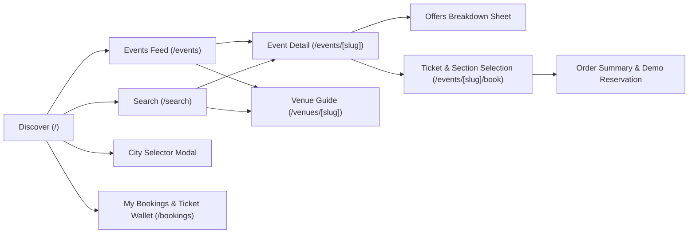

# NIGHTLIFEZ — Original Product Specification

## 1. Product Identity & IP Boundary

- **Product Name**: **NIGHTLIFEZ** (completely independent event discovery, venue guide, and ticketing platform)
- **Separation**: Zero shared source code, database, secrets, Vercel project, or domain with NIGHTLIFEZ or District.
- **Original Assets**: All branding, color tokens, typography, icons, copy, venue diagrams, and synthetic event catalog are original.

## 2. Core Design Tokens

- **Palette**:
  - Primary Accent: `#5B3DF5` (Electric Indigo)
  - Surface / Background: `#FFFFFF` / `#F7F7FA`
  - Ink Primary: `#111319`, Ink Muted: `#5E6473`
  - Status Tokens: Available (`#16A34A`), Nearly Sold (`#D97706`), Sold Out (`#DC2626`), Early/Pre-sale (`#7C3AED`)
- **Typography**: System sans / Inter-style clean geometric hierarchy with tabular numerals for prices (`₹1,299`).

## 3. Navigation & Information Architecture

## 4. Screen Inventory & Viewport Targets

- **Web Viewports Tested**: `320px`, `360px`, `375px`, `390px`, `412px`, `430px`, `768px`, `1024px`, `1280px`, `1440px`.
- **Android Targets**: Small phone (`360x640`), Standard phone (`390x844`), Large phone (`430x932`) with Expo Router native stack + bottom tabs.

| Screen ID | Route (Web / Mobile) | Core Capabilities |
|---|---|---|
| `SCR-01` | `/` / `DiscoverTab` | City selector pill, search trigger, category switcher (`All`, `Concerts`, `Festivals`, `Comedy`, `Nightlife`, `Sports`), featured & curated feeds |
| `SCR-02` | `/events` / `EventsTab` | Date quick-filters (`Today`, `Tomorrow`, `This Weekend`), category chips, price sort, event cards with live sales phase & offer badges |
| `SCR-03` | `/search` / `SearchScreen` | Live query search, tab filter (`All`, `Events`, `Venues`), trending chips, empty-query & zero-results states |
| `SCR-04` | `/events/[slug]` / `EventDetail` | Hero, date/time, venue link, sales timeline (`Early Access` -> `Pre-sale` -> `General Sale`), lineup, facilities, policies, offers sheet, sticky `Book tickets` bar |
| `SCR-05` | `/venues/[slug]` / `VenueGuide` | Address, operating status & weekly schedule, upcoming events, amenities grid |
| `SCR-06` | `/events/[slug]/book` / `TicketSelection` | Pre-selection quantity selector (`1`–`10`), interactive venue section map + tier cards, availability status (`Available`, `Nearly sold`, `Sold out`), offer promo code application, price + fee breakdown, demo reservation confirmation |
| `SCR-07` | `/bookings` / `BookingsTab` | Demo sign-in (synthetic attendee account, no real auth/payments), booking history, pass detail with non-transactional demo QR code, cancellation flow |

## 5. Business Logic & Pricing Rules (Shared Package)

- **Offer Eligibility**:
  - `PERCENT_CAP`: `min(subtotal * percent / 100, maxDiscount)` when `subtotal >= minOrderAmount` and `totalQty >= minQuantity`.
  - `FLAT`: `flatAmount` when `subtotal >= minOrderAmount` and `totalQty >= minQuantity`.
  - `BOGO_TIER` (e.g., Buy 2 Get 1): discounts cheapest eligible unit when `totalQty >= buyQty + freeQty`.
- **Fees & Taxes**: Platform convenience fee (`6%` of post-discount subtotal) + GST (`18%` on convenience fee), computed deterministically in `shared` and enforced server-side.
- **Sales Phases**: `UPCOMING`, `EARLY_ACCESS`, `PRE_SALE`, `GENERAL_SALE`, `SOLD_OUT`.
- **Demo Boundary**: Bookings create `CONFIRMED_DEMO` reservations with `paymentStatus = 'DEMO_NO_CHARGE'`. No real payment gateways or financial charges exist.
